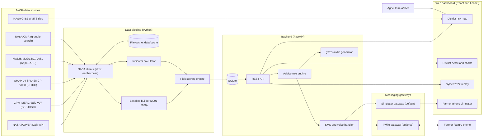

# PROJECT_SPEC.md: Krishi Kotha (কৃষি কথা)

Build specification for the NASA International Space Apps Challenge 2026 entry. Target executor: Google Antigravity (autonomous coding agent). Build window: 48 hours. Event dates: 14 to 15 November 2026.

---

## 1. Project Overview

| Field | Value |
|---|---|
| Name | Krishi Kotha (Bangla: "agriculture talk") |
| One-line pitch | NASA satellite data turned into plain Bangla SMS and voice advice for farmers, plus a district risk map for agriculture officers. |
| Challenge | Challenge 7: Field Shift: Adapting Farms with NASA Data |
| Team | Five members, Bangladesh |

**Problem.** Floods arrive earlier, dry spells last longer, and salt water moves further into coastal fields in Bangladesh. Farmers still plan sowing, irrigation and harvest by tradition. A single wrong timing decision can destroy a season. Useful NASA Earth observation data on rainfall, soil moisture and vegetation exists, but it is not usable by a farmer with a button phone and no internet, and it is hard for a district agriculture officer to read.

**Solution.** A pipeline ingests NASA data for selected districts and converts it into three transparent risk scores per district (drought, flood, salinity stress). A rule engine combines the scores with the farmer's crop and growth stage to produce a short Bangla message. The message is delivered by SMS or synthesized voice. A web dashboard shows the same risk scores on a district map for agriculture officers, and replays the June 2022 Sylhet flood to show that satellite rainfall data signalled the event days in advance.

**Target users.**
1. Smallholder rice farmers with feature phones (primary). Interaction is a text message such as `SYLHET AMAN`, or a voice call. No internet needed.
2. District and upazila agriculture officers (secondary). Interaction is the web dashboard.

**Expected impact.**
- Gives farmers time to harvest early, delay transplanting, drain fields or switch to fresh water for irrigation.
- Gives officers one view of where drought, flood and salinity pressure is building.
- Demonstrates a repeatable method (NASA data to local-language advice) that scales to any crop and any country by adding rows to configuration tables.

**Scope for the hackathon.** Rice only (Aman, Boro, Aus), eight districts, Bangla and English, simulated SMS and voice by default, real SMS and voice gateway as an optional upgrade.

---

## 2. Challenge Alignment

### 2.1 How the project addresses the challenge

The challenge theme is climate-resilient agriculture using NASA data. Krishi Kotha addresses it by (a) using NASA precipitation, soil moisture, weather and vegetation data to measure the three hazards that most affect Bangladeshi rice farming, (b) translating the measurements into decisions tied to crop stage, and (c) delivering the decisions over the channel that farmers actually have.

### 2.2 NASA datasets and access methods

Access note: NASA POWER, CMR search and GIBS tiles need no login. GES DISC (IMERG), NSIDC (SMAP) and AppEEARS (MODIS) require a free NASA Earthdata Login account.

| Dataset | Used for | Product or endpoint | Access method | Level |
|---|---|---|---|---|
| NASA POWER Daily API | Daily rainfall (`PRECTOTCORR`), max temperature (`T2M_MAX`), mean temperature (`T2M`), relative humidity (`RH2M`), root zone soil wetness (`GWETROOT`). Also builds the 2001 to 2020 baseline. | `GET https://power.larc.nasa.gov/api/temporal/daily/point?parameters=PRECTOTCORR,T2M_MAX,GWETROOT&community=AG&latitude={lat}&longitude={lon}&start={YYYYMMDD}&end={YYYYMMDD}&format=JSON`. Maximum 20 parameters per point request. No key required. | Direct HTTPS with `httpx`. | 1 |
| GPM IMERG Late Run, daily, V07 | Near-real-time rainfall accumulation (1, 3, 7, 30 day). Mean precipitation rate in mm/day on a 0.1 degree grid. | Collection short name `GPM_3IMERGDL`, version 07, DOI 10.5067/GPM/IMERGDL/DAY/07. Files under `https://gpm1.gesdisc.eosdis.nasa.gov/data/GPM_L3/GPM_3IMERGDL.07/{YYYY}/{MM}/`. Late Run latency is about 14 hours. | `earthaccess` Python library (search by short name, version, time, bounding box; download; subset with `xarray`). | 1 |
| GPM IMERG Final Run, daily, V07 | Event reconstruction and backtest for Sylhet 2022 (Final Run is the research-quality product, latency about 3.5 months). | Collection short name `GPM_3IMERGDF`, version 07. | `earthaccess`, same code path as Late Run with a different short name. | 1 |
| NASA CMR (Common Metadata Repository) | Granule discovery and availability checks for every Earthdata collection. | `GET https://cmr.earthdata.nasa.gov/search/granules.json?short_name={name}&version={v}&temporal={start},{end}&bounding_box={w},{s},{e},{n}` | `httpx`. | 1 |
| SMAP L4 Global 3-hourly 9 km Surface and Root Zone Soil Moisture (SPL4SMGP), V008 | Root zone soil moisture percentile (`sm_rootzone_pctl`) for drought and flood antecedent conditions. | Short name `SPL4SMGP`, version 008, DOI 10.5067/T5RUATAQREF8. | `earthaccess` plus `h5py`. One granule per day near 06:00 UTC (midday in Bangladesh). | 2 |
| MODIS Vegetation Indices, Terra, 16-day 250 m (MOD13Q1), V061 | NDVI anomaly as a crop health and salinity stress signal. | AppEEARS API base `https://appeears.earthdatacloud.nasa.gov/api/`. Task type `point`. Layer `_250m_16_days_NDVI`. Fallback: VIIRS vegetation index product `VNP13A1` if listed in the AppEEARS product catalogue and MOD13Q1 is unavailable for the period. | `httpx` against the AppEEARS REST API (login, submit task, poll status, download). | 2 |
| NASA GIBS WMTS | Visual overlay of NASA imagery on the map. | Tile template `https://gibs.earthdata.nasa.gov/wmts/epsg3857/best/{layer}/default/{YYYY-MM-DD}/{TileMatrixSet}/{z}/{y}/{x}.png`. Candidate layers to verify against GetCapabilities: `IMERG_Precipitation_Rate`, `MODIS_Terra_NDVI_8Day`. Capabilities: `https://gibs.earthdata.nasa.gov/wmts/epsg3857/best/wmts.cgi?SERVICE=WMTS&REQUEST=GetCapabilities`. | Leaflet `TileLayer`. | 2 |
| GEOS-FP forecast (NASA GMAO) | Optional forward-looking rainfall. | Not used in Levels 1 and 2. The OPeNDAP path must be verified before any use (see Open Questions). | Not applicable until verified. | 3 |

Non-NASA static inputs (clearly labelled in the UI as non-NASA): district centroids, approximate distance to coast, and the rice crop calendar. These are configuration files, not data feeds.

---

## 3. Judging Criteria Mapping

| Criterion | What satisfies it | Where it lives |
|---|---|---|
| Impact | Delivers advice to feature phone users with no internet, in Bangla. Targets the three hazards most damaging to Bangladeshi rice. Officer dashboard for district planning. Feedback replies ("1" helpful, "2" not helpful) create a measurement loop. | F1.9, F1.10, F2.4, F2.5, F3.6; dashboard F1.7 |
| Creativity | NASA data converted to a two-line Bangla SMS or voice message tied to crop stage. Salinity stress proxy built from NASA signals where no direct NASA product exists. Upstream catchment rainfall for the haor districts. Event replay in the same five steps as the pitch slide. | F1.5, F1.9, F2.3, F3.1 |
| Validity | Named NASA collections with versions. Transparent formulas, no black box. Climatology baseline from 20 years of NASA POWER. Backtest against Sylhet June 2022 with lead time, hits and false alarms reported honestly. Seasonality sanity tests. Every number in the UI shows its source and data date. Limitations stated on the Method page. | F1.4, F1.5, F2.3, F2.8; Section 10 |
| Relevance | Directly answers Challenge 7 (adapting farms with NASA data). Uses rainfall, soil moisture, temperature and vegetation, the data classes named in the pitch. Local context: Bangladesh, rice seasons, Bangla language. | Sections 2 and 4 |
| Presentation | Under three minutes demo script. A map, a phone mockup, and the 2022 replay give three strong visuals. Clean bilingual UI, accessible colour palette. README, architecture diagram and methodology page. | Section 12; F2.3, F2.8; UI Section 8 |

---

## 4. Feature Breakdown

Priority levels: Level 1 is required for a working demo. Level 2 strengthens validity and impact. Level 3 adds creativity and polish. Do not start a Level 2 feature until every Level 1 acceptance criterion passes.

### Level 1 (MVP, must-have)

**F1.1 District and crop registry**
Description: Static configuration for eight districts and three rice crops with growth stages, loaded into the database.
Acceptance criteria:
- `data/static/districts.json` has 8 districts, each with `id`, English and Bangla names, division, latitude, longitude, `coastal_distance_km`.
- `data/static/crops.json` has Aman, Boro and Aus with stage calendars (Section 7.5).
- `python -m backend.app.seed` is idempotent: running twice leaves exactly 8 districts and 3 crops.

**F1.2 NASA POWER ingestion**
Description: Client that fetches daily `PRECTOTCORR`, `T2M_MAX`, `RH2M`, `GWETROOT` for a district centroid and date range, with caching and retry.
Acceptance criteria:
- For Sylhet, 2022-06-01 to 2022-06-30, returns 30 daily rows with no fill values (-999) left in the output; fill values are converted to null.
- Second identical call reads from `data/cache/power/` with no HTTP request (verified by a unit test with a mocked client).
- HTTP 429 or 5xx triggers up to 3 retries with exponential backoff.

**F1.3 GPM IMERG ingestion**
Description: Authenticates with Earthdata Login, finds daily granules through `earthaccess`, clips to the Bangladesh bounding box (west 88.0, south 20.5, east 92.7, north 26.7), caches the clipped file, and extracts district-box mean rainfall (centroid plus or minus 0.25 degrees).
Acceptance criteria:
- Returns mm/day for each of the 8 districts for any date from 2022-05-15 onward.
- Raw global granule is deleted after clipping; each cached clipped file is under 5 MB.
- If Earthdata login fails, the function raises `EarthdataAuthError` with a message naming the missing environment variables.

**F1.4 Rainfall and soil climatology baseline**
Description: For each district, build a 2001 to 2020 baseline from POWER: for each calendar day, the distribution (within plus or minus 15 days) of 3-day and 7-day rainfall sums, 30-day rainfall mean, mean `T2M_MAX`, and `GWETROOT` values.
Acceptance criteria:
- `data/baseline/{district_id}.json` exists for all 8 districts.
- Baseline 30-day rainfall mean for Sylhet in mid-June is greater than for Rajshahi in mid-June (sanity check; Sylhet is far wetter).
- Baseline build for all districts completes in under 10 minutes.

**F1.5 Risk scoring engine**
Description: Pure-Python module that computes drought, flood and salinity stress scores (0 to 100) and levels (Low, Moderate, High) using the formulas in Section 7.6, and returns the contributing inputs for explanation.
Acceptance criteria:
- Deterministic: same inputs produce same outputs (unit tested with fixed fixtures).
- Every score is accompanied by an `inputs` object listing each raw value, its normalized sub-score and its weight.
- Scores are clamped to 0 to 100; missing optional inputs trigger the documented fallback formula and set `degraded: true`.

**F1.6 Read API**
Description: FastAPI endpoints for districts, risk for a date, risk time series, explanation, and data provenance (Section 7.7).
Acceptance criteria:
- `GET /api/risk?date=2022-06-16` returns 8 district entries in under 500 ms from SQLite.
- OpenAPI docs at `/docs` list every route.
- Unknown district returns HTTP 404 with a JSON error body.

**F1.7 District risk map dashboard**
Description: Leaflet map with one circle marker per district coloured by the selected hazard, hazard toggle (Drought, Flood, Salinity), date picker, legend, data freshness label.
Acceptance criteria:
- Marker colours match the level of the selected hazard for the selected date.
- Switching hazard updates colours without a page reload and in under 300 ms.
- Page is usable at 360 px width.

**F1.8 District detail panel**
Description: Selecting a district opens a panel with the three scores, a 60-day rainfall chart with the baseline 90th percentile band, soil wetness line, and a factor breakdown.
Acceptance criteria:
- All numbers in the panel come from `/api/risk/{district_id}` and `/explain`.
- Each score shows its input values and the NASA source name and data date.

**F1.9 Bangla advice engine**
Description: Rule engine selecting a message template from (hazard, level, crop, growth stage), rendered in Bangla and English (Section 7.4).
Acceptance criteria:
- Every template renders without unresolved placeholders for all 8 districts and 3 crops (parametrized test).
- Bangla SMS body is at most 134 characters (two Unicode SMS segments). A test fails if any template exceeds this.
- When no hazard is Moderate or High, the "no major risk" template is returned.

**F1.10 SMS simulator**
Description: Parser and handler for inbound text such as `SYLHET AMAN` (English or Bangla names), returning the Bangla advice and a registration confirmation. A simulator page provides a phone mockup that calls the same handler.
Acceptance criteria:
- `SYLHET AMAN`, `sylhet aman`, `সিলেট আমন` all resolve to the same district and crop.
- Invalid input returns the Bangla help message (Section 7.4).
- `STOP` deactivates the subscriber.

**F1.11 Snapshot mode**
Description: A committed snapshot of computed risk for 2022-05-15 to 2022-06-30 and the latest 30 days, so the demo works without network access.
Acceptance criteria:
- `DATA_MODE=snapshot` serves all API routes with no outbound HTTP calls (verified by running with network disabled).

### Level 2 (Core)

**F2.1 SMAP root zone soil moisture**
Description: Download one SPL4SMGP granule per day, read `sm_rootzone_pctl` at each district centroid, and use it in place of POWER `GWETROOT` where available.
Acceptance criteria:
- Soil input source is recorded per score (`SMAP_L4` or `POWER_GWETROOT`).
- If SMAP is unavailable for the date, scoring falls back to POWER and the UI shows the fallback source.
- Latest SMAP granule date is checked through CMR and displayed on the Method page.

**F2.2 MODIS NDVI anomaly**
Description: AppEEARS point task for each district, 16-day NDVI compared to the 2003 to 2020 mean for the same period, used as `s_veg` in the salinity formula and as a crop health indicator.
Acceptance criteria:
- NDVI anomaly appears in the district detail panel with the product name and version.
- If the task is pending or fails, scores fall back to the formula without NDVI and `degraded: true`.

**F2.3 Sylhet 2022 event replay and backtest**
Description: Replays 2022-05-15 to 2022-06-30 for Sylhet using IMERG Final Run, shows the five steps from the pitch slide (rain begins, rain builds, heavy rain, extreme rain, flood) on a timeline, and computes lead time between the first High flood level and the reference flood onset date.
Acceptance criteria:
- `GET /api/backtest/sylhet-2022` returns daily series, first Moderate date, first High date, reference onset date, lead time in days.
- UI timeline highlights the five steps with dates derived from data, not hard-coded.
- Thresholds are fixed in configuration before the backtest runs and are not tuned on this event (documented in `docs/methodology.md`).

**F2.4 Voice advice**
Description: Generate Bangla speech from advice text with gTTS (language code `bn`), store the MP3, and offer a "Call" button in the simulator that plays it.
Acceptance criteria:
- `GET /api/audio/{filename}` returns `audio/mpeg`.
- Audio is cached by a hash of the text; the same text does not trigger a second TTS call.
- If gTTS fails (offline), the endpoint returns HTTP 503 with a JSON message and the simulator shows the text only.

**F2.5 Twilio SMS and voice gateway (optional, behind a flag)**
Description: Gateway adapter that sends SMS and answers inbound SMS and voice webhooks when `TWILIO_ENABLED=true`.
Acceptance criteria:
- With the flag off, no Twilio import is executed and the app starts normally.
- Inbound webhook validates the Twilio signature when enabled.
- Voice webhook returns TwiML that plays the cached MP3 through a public URL.

**F2.6 NASA GIBS overlays**
Description: Toggle IMERG precipitation and MODIS NDVI tile layers on the map for the selected date.
Acceptance criteria:
- Layer identifiers are confirmed from GetCapabilities in Phase 10 and stored in `frontend/src/config/layers.js`.
- Toggling a layer adds or removes it; attribution "NASA GIBS" is visible.

**F2.7 Subscriber registry and broadcast preview**
Description: Subscribers created through SMS registration; admin endpoint previews a broadcast to a district at or above a minimum level, with dry-run default.
Acceptance criteria:
- `POST /api/admin/broadcast` with `dry_run=true` returns recipient count and message text, and sends nothing.
- Endpoint rejects requests without a valid `X-Admin-Key` header.

**F2.8 Data provenance and methodology page**
Description: Page listing each NASA dataset, version, latency, resolution, last data date, formulas and known limitations.
Acceptance criteria:
- Content is loaded from `/api/sources` so it cannot drift from the code.
- Limitations section includes the points in Section 13.

### Level 3 (Stretch)

**F3.1 Upstream catchment rainfall.** For Sylhet and Sunamganj, add rainfall over an upstream box (west 91.0, south 24.8, east 92.4, north 25.6, working assumption) to the flood formula. Acceptance: flood explanation shows local and upstream rainfall separately.
**F3.2 All 64 districts.** Load geoBoundaries ADM2 polygons for Bangladesh and render a choropleth. Acceptance: map shows 64 polygons; pipeline completes within 30 minutes.
**F3.3 Forecast layer.** Add a clearly labelled forecast rainfall input from NASA GEOS-FP after the endpoint is verified. Acceptance: forecast values are visually separate from observations; messages that mention the coming week are only generated when forecast data is present.
**F3.4 Flood validation with NASA flood product.** Compare flood alerts with the MODIS near-real-time global flood product (LANCE, `MCDWD`) if accessible. Acceptance: validation table added to `docs/methodology.md`.
**F3.5 Officer bulletin.** Print-friendly one-page district bulletin and CSV and GeoJSON export. Acceptance: browser print produces a single A4 page.
**F3.6 Farmer feedback loop.** Reply `1` (helpful) or `2` (not helpful) is logged against the last message. Acceptance: dashboard shows helpful ratio in the About page.

---

## 5. System Architecture

### 5.1 Component diagram



### 5.2 Data flow from NASA source to user interface

1. A scheduled run (`python -m pipeline.run_pipeline`) asks CMR which granules exist for the latest dates.
2. NASA clients fetch POWER time series, IMERG daily granules (clipped to the Bangladesh box, then cached), and, at Level 2, SMAP granules and MODIS NDVI from AppEEARS.
3. The indicator calculator converts raw series into per-district indicators: 1, 3, 7 and 30 day rainfall, soil wetness percentile, maximum temperature anomaly, NDVI anomaly.
4. The scoring engine compares indicators with the district baseline and writes one `risk_snapshot` row per district per date, including the inputs and data versions used.
5. The REST API reads snapshots from SQLite. The advice engine selects a template for a (district, crop, stage) combination from the latest snapshot.
6. The React dashboard calls the REST API and renders the map and charts. GIBS tiles are loaded directly from NASA by the browser.
7. For farmers, an inbound SMS or simulator message reaches the SMS handler, which calls the advice engine and returns Bangla text. Voice requests additionally return a cached MP3.

### 5.3 Technology stack

| Layer | Choice | Justification |
|---|---|---|
| Language (backend) | Python 3.11 | Standard for NASA data libraries; fastest path to xarray and earthaccess. |
| Web framework | FastAPI with Uvicorn | Automatic OpenAPI docs, Pydantic validation, simple async routes. |
| Database | SQLite via SQLAlchemy 2 | Zero setup; adequate for 8 to 64 districts and daily rows. |
| NASA access | `httpx`, `earthaccess` | `httpx` for open REST (POWER, CMR, AppEEARS); `earthaccess` handles Earthdata Login and granule search. |
| Array processing | `xarray`, `netCDF4`, `h5py`, `numpy`, `pandas` | IMERG is NetCDF4/HDF5, SMAP L4 is HDF5. |
| Scheduling | Plain script plus cron or Windows Task Scheduler | Simpler than a scheduler library; one daily run. |
| Text to speech | `gTTS` (language `bn`) | Free, no key, supports Bangla. Replaceable behind an interface. |
| Messaging | Gateway interface with a simulator and a Twilio adapter | Demo works without paid accounts; real delivery is a flag away. |
| Frontend | React 18, Vite | Fast scaffold, wide agent familiarity. |
| Map | Leaflet with `react-leaflet` | Lightweight, works with NASA GIBS WMTS tiles. |
| Charts | Recharts | Simple declarative charts in React. |
| Styling | Plain CSS with design tokens | No build-time dependency risk. |
| Fonts | `@fontsource/noto-sans-bengali`, `@fontsource/inter` | Self-hosted so Bangla renders offline. |
| Tests | `pytest`, `respx` (HTTP mocking), `vitest` | Fast unit tests with mocked NASA calls. |

---

## 6. Folder and File Structure

```text
krishi-kotha/
├── PROJECT_SPEC.md                      # This specification
├── README.md                            # Project overview, setup, demo instructions
├── .env.example                         # Every required environment variable, no secrets
├── .gitignore                           # Ignores .env, data/cache, *.db, node_modules, venv
├── requirements.txt                     # Python dependencies
├── data/
│   ├── static/
│   │   ├── districts.json               # 8 seed districts with coordinates and attributes
│   │   ├── crops.json                   # Rice crops with growth stage calendars and sensitivity
│   │   ├── advice_templates.json        # Bangla and English message templates keyed by rule id
│   │   └── districts.geojson            # Level 3: ADM2 polygons (geoBoundaries)
│   ├── baseline/                        # Per-district 2001-2020 climatology JSON (generated, committed)
│   ├── snapshots/                       # Precomputed risk snapshots for offline demo (committed)
│   │   ├── latest_30d.json              # Latest 30 days of risk for all districts
│   │   └── sylhet_2022.json             # Precomputed event replay for Sylhet
│   ├── cache/                           # Raw and clipped NASA downloads (gitignored)
│   └── audio/                           # Generated MP3 files (gitignored)
├── backend/
│   ├── app/
│   │   ├── __init__.py                  # Package marker
│   │   ├── main.py                      # FastAPI app factory, CORS, static file mount, router wiring
│   │   ├── config.py                    # Settings loaded from environment (pydantic-settings)
│   │   ├── db.py                        # SQLAlchemy engine, session dependency, table creation
│   │   ├── models.py                    # ORM models (Section 7.1)
│   │   ├── schemas.py                   # Pydantic request and response models
│   │   ├── seed.py                      # Loads districts and crops from data/static into the DB
│   │   ├── routers/
│   │   │   ├── meta.py                  # /api/health, /api/sources, /api/layers, /api/pipeline/status
│   │   │   ├── districts.py             # /api/districts and /api/crops
│   │   │   ├── risk.py                  # /api/risk routes: map data, time series, explanation
│   │   │   ├── advice.py                # /api/advice
│   │   │   ├── messaging.py             # /api/sim/sms, /api/sms/inbound, /api/voice/inbound, /api/audio
│   │   │   ├── backtest.py              # /api/backtest/sylhet-2022
│   │   │   └── admin.py                 # /api/admin/pipeline/run, /api/admin/broadcast
│   │   └── services/
│   │       ├── nasa/
│   │       │   ├── earthdata_auth.py    # earthaccess login using environment variables
│   │       │   ├── cmr.py               # CMR granule search and latest-date lookup
│   │       │   ├── power.py             # POWER daily point client with cache and retry
│   │       │   ├── imerg.py             # IMERG search, download, clip, district-box extraction
│   │       │   ├── smap.py              # Level 2: SPL4SMGP granule read at district points
│   │       │   └── modis.py             # Level 2: AppEEARS point task client for NDVI
│   │       ├── risk/
│   │       │   ├── baseline.py          # Builds and loads per-district climatology
│   │       │   ├── indicators.py        # Rolling sums, percentiles, anomalies
│   │       │   └── scoring.py           # Drought, flood, salinity formulas and level mapping
│   │       ├── advice/
│   │       │   ├── stages.py            # Maps date and crop to growth stage
│   │       │   ├── rules.py             # Rule table: (hazard, level, crop, stage) to template id
│   │       │   └── composer.py          # Fills templates, enforces length limit, returns bn and en
│   │       ├── messaging/
│   │       │   ├── parser.py            # Parses inbound text into district, crop or command
│   │       │   ├── handler.py           # Shared inbound handler used by simulator and Twilio
│   │       │   ├── gateway.py           # Gateway interface (send_sms, voice_response)
│   │       │   ├── sim_gateway.py       # Simulator gateway: records messages, no network
│   │       │   ├── twilio_gateway.py    # Level 2: Twilio adapter, imported only when enabled
│   │       │   └── tts.py               # gTTS wrapper with hash-based audio cache
│   │       └── backtest.py              # Replay and lead-time metrics
│   └── tests/
│       ├── conftest.py                  # Shared fixtures, in-memory DB, mocked HTTP
│       ├── fixtures/                    # Saved small POWER and IMERG sample responses
│       ├── test_power_client.py         # POWER parsing, fill values, cache, retry
│       ├── test_imerg_client.py         # Clipping and district-box mean on a tiny synthetic grid
│       ├── test_indicators.py           # Rolling sums and percentile ranks
│       ├── test_scoring.py              # Formula outputs, clamping, fallbacks
│       ├── test_advice.py               # Template completeness and length limit
│       ├── test_parser.py               # SMS parsing in English and Bangla
│       ├── test_api.py                  # Route status codes and response shapes
│       └── test_backtest.py             # Lead time calculation on a synthetic series
├── pipeline/
│   ├── build_baseline.py                # CLI: builds data/baseline/*.json from POWER 2001-2020
│   ├── run_pipeline.py                  # CLI: fetch, compute indicators, score, write snapshots
│   └── build_snapshot.py                # CLI: exports DB risk rows to data/snapshots/*.json
├── scripts/
│   ├── verify_endpoints.py              # Smoke test of every NASA endpoint used
│   └── check_env.py                     # Confirms required environment variables are set
├── frontend/
│   ├── package.json                     # Dependencies and npm scripts
│   ├── vite.config.js                   # Vite config; envDir points to repo root; /api dev proxy
│   ├── index.html                       # HTML shell with lang attribute and viewport meta
│   ├── public/favicon.svg               # Site icon
│   └── src/
│       ├── main.jsx                     # React entry point
│       ├── App.jsx                      # Router and layout
│       ├── api/client.js                # Fetch wrapper for the backend API
│       ├── config/layers.js             # GIBS layer ids, tile matrix sets, hazard colour scale
│       ├── i18n/
│       │   ├── index.js                 # Language state and t() helper
│       │   ├── en.json                  # English UI strings
│       │   └── bn.json                  # Bangla UI strings
│       ├── pages/
│       │   ├── Dashboard.jsx            # Map, hazard toggle, date control, district panel
│       │   ├── EventReplay.jsx          # Sylhet 2022 timeline and chart
│       │   ├── Simulator.jsx            # Phone mockup for SMS and voice
│       │   └── Method.jsx               # Data sources, formulas, limitations
│       ├── components/
│       │   ├── Layout.jsx               # Header, language toggle, navigation
│       │   ├── RiskMap.jsx              # Leaflet map with district markers and GIBS overlays
│       │   ├── HazardToggle.jsx         # Drought, Flood, Salinity radio group
│       │   ├── Legend.jsx               # Low, Moderate, High legend
│       │   ├── RiskBadge.jsx            # Level chip with text and colour
│       │   ├── DistrictPanel.jsx        # Scores, advice preview, data freshness
│       │   ├── TrendChart.jsx           # Rainfall and soil wetness chart with baseline band
│       │   ├── FactorBars.jsx           # Horizontal bars for score inputs and weights
│       │   ├── PhoneMockup.jsx          # Feature-phone frame with message list
│       │   ├── AdviceCard.jsx           # Bangla and English advice with audio button
│       │   └── DataFreshness.jsx        # Source name, product version, data date
│       ├── styles/
│       │   ├── tokens.css               # Colour, spacing and type variables
│       │   └── global.css               # Reset and base styles
│       ├── utils/
│       │   ├── risk.js                  # Level to colour and label helpers
│       │   └── format.js                # Number and date formatting, Bangla digits option
│       └── __tests__/risk.test.js       # Vitest tests for level and colour helpers
└── docs/
    ├── architecture.md                  # Diagram and data flow description
    ├── methodology.md                   # Formulas, baseline, backtest design and results
    ├── data_sources.md                  # Dataset table with versions and access notes
    ├── demo_script.md                   # Three-minute demo script and talking points
    └── assets/                          # Screenshots and diagram exports for the submission
```

---

## 7. Data Model and API Design

### 7.1 Entities

All tables use SQLite. `id` columns are integers unless noted. Timestamps are UTC ISO 8601.

**District**
| Field | Type | Notes |
|---|---|---|
| id | string (PK) | Slug, for example `sylhet` |
| name_en, name_bn | string | Display names |
| division | string | For example `Sylhet` |
| lat, lon | float | District centroid |
| coastal_distance_km | float | Approximate, from configuration |
| upstream_bbox | JSON or null | Level 3: [west, south, east, north] |

**Crop**
| Field | Type | Notes |
|---|---|---|
| id | string (PK) | `aman`, `boro`, `aus` |
| name_en, name_bn | string | |
| stages | JSON | List of stage objects (Section 7.5) |

**Observation** (raw extracted values)
| Field | Type | Notes |
|---|---|---|
| id | int (PK) | |
| district_id | FK District | |
| date | date | |
| source | string | `POWER`, `IMERG_LATE`, `IMERG_FINAL`, `SMAP_L4`, `MODIS_MOD13Q1` |
| variable | string | `precip_mm`, `tmax_c`, `rh2m`, `soil_wetness`, `rz_pctl`, `ndvi` |
| value | float or null | |
| product_version | string | For example `V07`, `V008`, `061` |
| Unique | | (district_id, date, source, variable) |

**Baseline**
| Field | Type | Notes |
|---|---|---|
| district_id | FK District | |
| doy | int | Day of year (1 to 366) |
| rain3_sorted | JSON | Sorted 3-day rainfall sums sample for the plus or minus 15 day window |
| rain7_sorted | JSON | Sorted 7-day rainfall sums sample |
| rain30_mean | float | Mean 30-day rainfall |
| tmax_mean | float | Mean daily maximum temperature |
| soil_sorted | JSON | Sorted `GWETROOT` sample |
| ndvi_mean | float or null | Level 2 |

**RiskSnapshot**
| Field | Type | Notes |
|---|---|---|
| id | int (PK) | |
| district_id | FK District | |
| date | date | Effective date of the score |
| drought_score, flood_score, salt_score | float | 0 to 100 |
| drought_level, flood_level, salt_level | string | `low`, `moderate`, `high` |
| inputs | JSON | Raw values, sub-scores and weights |
| sources | JSON | Product names, versions, last data date for each input |
| degraded | bool | True if a fallback formula was used |
| created_at | datetime | |
| Unique | | (district_id, date) |

**Subscriber**
| Field | Type | Notes |
|---|---|---|
| id | int (PK) | |
| phone_e164 | string | Demo numbers only; see privacy risk in Section 13 |
| phone_hash | string | SHA-256 with salt; used for lookups |
| district_id | FK District | |
| crop_id | FK Crop | |
| language | string | `bn` default |
| active | bool | |
| created_at | datetime | |

**MessageLog**
| Field | Type | Notes |
|---|---|---|
| id | int (PK) | |
| subscriber_id | FK Subscriber or null | |
| direction | string | `in` or `out` |
| channel | string | `sms`, `voice`, `sim` |
| body | string | |
| rule_id | string or null | Advice rule used |
| created_at | datetime | |

**PipelineRun**
| Field | Type | Notes |
|---|---|---|
| id | int (PK) | |
| started_at, finished_at | datetime | |
| status | string | `ok`, `partial`, `failed` |
| detail | JSON | Per-source status and last data dates |

Relationships: District 1..n RiskSnapshot, Observation, Baseline, Subscriber. Crop 1..n Subscriber. Subscriber 1..n MessageLog.

### 7.2 Internal API routes

Base path `/api`. All responses are JSON unless noted. Dates use `YYYY-MM-DD`.

| Method | Path | Request | Response |
|---|---|---|---|
| GET | `/api/health` | none | `{"status":"ok","data_mode":"live","version":"1.0.0"}` |
| GET | `/api/districts` | none | `[{"id":"sylhet","name_en":"Sylhet","name_bn":"সিলেট","lat":24.8949,"lon":91.8687,"division":"Sylhet"}]` |
| GET | `/api/crops` | none | `[{"id":"aman","name_en":"Aman rice","name_bn":"আমন ধান"}]` |
| GET | `/api/risk` | Query: `date` (optional, default latest), `hazard` (optional: `drought`, `flood`, `salt`) | `{"date":"2022-06-16","districts":[{"district_id":"sylhet","drought":{"score":12.4,"level":"low"},"flood":{"score":84.0,"level":"high"},"salt":{"score":5.0,"level":"low"},"degraded":false}]}` |
| GET | `/api/risk/{district_id}` | Query: `days` (default 60, max 365) | `{"district_id":"sylhet","series":[{"date":"2022-06-14","drought_score":10.1,"flood_score":61.0,"salt_score":4.0,"rain_mm":78.2,"soil_wetness":0.91}]}` |
| GET | `/api/risk/{district_id}/explain` | Query: `date` (optional) | `{"district_id":"sylhet","date":"2022-06-16","flood":{"score":84.0,"inputs":[{"name":"rain3_pctl","value":97.0,"weight":0.40,"source":"GPM IMERG V07","data_date":"2022-06-16"}]},"degraded":false}` |
| POST | `/api/advice` | `{"district_id":"sylhet","crop_id":"aman","date":"2022-06-16","language":"bn"}` | `{"rule_id":"flood_high_harvest","text_bn":"...","text_en":"...","hazard":"flood","level":"high","audio_url":"/api/audio/3f2a.mp3"}` |
| POST | `/api/sim/sms` | `{"from":"+8801700000000","body":"SYLHET AMAN"}` | `{"replies":[{"text":"..."}],"subscriber_id":12}` |
| POST | `/api/sms/inbound` | Twilio form fields `From`, `Body` | TwiML XML (`text/xml`) containing the reply |
| POST | `/api/voice/inbound` | Twilio form fields `From`, `Digits` (optional) | TwiML XML with `<Play>` of the audio URL |
| GET | `/api/audio/{filename}` | none | `audio/mpeg` file, or 404 / 503 |
| GET | `/api/backtest/sylhet-2022` | none | `{"district_id":"sylhet","series":[...],"first_moderate":"2022-06-09","first_high":"2022-06-13","reference_onset":"2022-06-16","lead_time_days":3,"steps":[{"step":1,"label":"Rain begins","date":"2022-06-05"}]}` (values illustrative) |
| GET | `/api/sources` | none | List of datasets with `name`, `short_name`, `version`, `resolution`, `latency`, `last_data_date`, `url` |
| GET | `/api/layers` | none | GIBS layer configuration used by the map |
| GET | `/api/pipeline/status` | none | Last `PipelineRun` row |
| POST | `/api/admin/pipeline/run` | Header `X-Admin-Key`; body `{"mode":"live","as_of":"2026-11-14"}` | `{"run_id":7,"status":"started"}` |
| POST | `/api/admin/broadcast` | Header `X-Admin-Key`; body `{"district_id":"sylhet","min_level":"moderate","dry_run":true}` | `{"recipients":14,"sample_text_bn":"...","sent":0}` |

Error format for all routes: `{"error":{"code":"not_found","message":"District 'xyz' does not exist"}}`.

### 7.3 Shared types

- `level`: one of `low`, `moderate`, `high`.
- `hazard`: one of `drought`, `flood`, `salt`.
- Level thresholds: score below 40 is `low`, 40 to 69.99 is `moderate`, 70 and above is `high`. Defined once in `scoring.py` and mirrored in `frontend/src/utils/risk.js`.

### 7.4 Advice templates and SMS commands

Rule selection order: evaluate hazards in the order flood, drought, salt; effective value is `score * crop_stage_sensitivity` (Section 7.5), capped at 100; choose the hazard with the highest effective value at or above 40; if none, use `none_low`. One message per request.

Templates (initial set; a native Bangla speaker on the team must review wording before the demo):

| rule_id | Condition | Bangla (`text_bn`) | English (`text_en`) |
|---|---|---|---|
| `drought_high_transplant` | drought high, crop Aman, stage nursery or transplanting | আপনার জমির মাটি খুব শুকনো। আমন ধান রোপণের আগে ৫ দিন অপেক্ষা করুন। | Your soil is very dry. Wait 5 days before transplanting Aman rice. |
| `drought_moderate_any` | drought moderate, any stage | মাটির আর্দ্রতা কমছে। সম্ভব হলে ভোরে বা সন্ধ্যায় হালকা সেচ দিন। | Soil moisture is falling. If possible, give light irrigation at dawn or dusk. |
| `flood_high_harvest` | flood high, stage grain filling or harvest | গত কয়েক দিনে অনেক বৃষ্টি হয়েছে, বন্যার ঝুঁকি বাড়ছে। সম্ভব হলে আগেই ধান কেটে ফেলুন। | Heavy rain has fallen in recent days and flood risk is rising. If possible, harvest the rice early. |
| `flood_high_early` | flood high, other stages | বন্যার ঝুঁকি বেশি। জমির পানি বের করার নালা পরিষ্কার রাখুন এবং বীজতলা উঁচু স্থানে রাখুন। | Flood risk is high. Keep drainage channels clear and keep seedbeds on high ground. |
| `flood_moderate_any` | flood moderate, any stage | এই এলাকায় বৃষ্টি বাড়ছে। জমির পানি বের করার নালা পরিষ্কার রাখুন। | Rain is increasing in your area. Keep field drainage channels clear. |
| `salt_high_any` | salt high or moderate, any stage | আপনার এলাকায় লবণাক্ততার ঝুঁকি বেশি। সেচের আগে পানি পরীক্ষা করুন এবং সম্ভব হলে মিঠা পানি ব্যবহার করুন। | Salinity risk is high in your area. Test water before irrigation and use fresh water if possible. |
| `none_low` | no hazard at or above 40 | এখন বড় কোনো ঝুঁকি নেই। স্বাভাবিকভাবে চাষ চালিয়ে যান। | No major risk right now. Continue farming as normal. |
| `welcome` | registration confirmed | কৃষি কথায় স্বাগতম। আপনার এলাকা ও ফসল নথিভুক্ত হয়েছে। আমরা সতর্কবার্তা পাঠাব। | Welcome to Krishi Kotha. Your area and crop are registered. We will send you alerts. |
| `help` | parse failure | বুঝতে পারিনি। এভাবে লিখুন: SYLHET AMAN | We did not understand. Write like this: SYLHET AMAN |
| `stopped` | STOP command | আপনার সাবস্ক্রিপশন বন্ধ হয়েছে। | Your subscription has been stopped. |

Note on message wording: Level 1 and 2 messages describe observed rainfall and soil conditions. Messages must not claim a forecast ("next week") unless Level 3 forecast data is present.

SMS grammar: `<DISTRICT> <CROP>` where district and crop are English or Bangla names (case-insensitive, whitespace-tolerant). Commands: `HELP`, `STOP`, `1`, `2` (feedback, Level 3). Unicode normalization (NFC) applied before matching.

### 7.5 Static configuration schemas

`data/static/districts.json` (seed values are approximate; refine coordinates and coastal distance if time allows):

| id | name_en | name_bn | division | lat | lon | coastal_distance_km | Primary hazard focus |
|---|---|---|---|---|---|---|---|
| sylhet | Sylhet | সিলেট | Sylhet | 24.8949 | 91.8687 | 250 | Flood |
| sunamganj | Sunamganj | সুনামগঞ্জ | Sylhet | 25.0658 | 91.4073 | 280 | Flood |
| khulna | Khulna | খুলনা | Khulna | 22.8456 | 89.5403 | 60 | Salinity, flood |
| satkhira | Satkhira | সাতক্ষীরা | Khulna | 22.7185 | 89.0705 | 30 | Salinity |
| barishal | Barishal | বরিশাল | Barishal | 22.7010 | 90.3535 | 70 | Flood, salinity |
| rajshahi | Rajshahi | রাজশাহী | Rajshahi | 24.3745 | 88.6042 | 350 | Drought |
| rangpur | Rangpur | রংপুর | Rangpur | 25.7439 | 89.2752 | 330 | Drought, flood |
| chattogram | Chattogram | চট্টগ্রাম | Chattogram | 22.3569 | 91.7832 | 10 | Flood, salinity |

`data/static/crops.json` stage calendar (assumption; to be checked against BRRI Rice Knowledge Bank). Months are inclusive, calendar months:

| Crop | Stage key | Months | Flood sensitivity | Drought sensitivity | Salt sensitivity |
|---|---|---|---|---|---|
| aman | nursery | Jun to Jul | 1.0 | 1.2 | 0.8 |
| aman | transplanting | Jul to Aug | 1.1 | 1.2 | 0.9 |
| aman | vegetative | Aug to Sep | 1.0 | 1.0 | 1.0 |
| aman | flowering | Sep to Oct | 1.1 | 1.2 | 1.0 |
| aman | grain_filling_harvest | Nov to Dec | 1.3 | 0.5 | 0.6 |
| boro | seedbed | Nov to Dec | 0.8 | 0.8 | 0.9 |
| boro | transplanting | Dec to Jan | 0.6 | 1.0 | 1.2 |
| boro | vegetative | Jan to Feb | 0.6 | 1.1 | 1.2 |
| boro | flowering | Mar | 0.8 | 1.2 | 1.3 |
| boro | grain_filling_harvest | Apr to May | 1.3 | 0.6 | 1.0 |
| aus | sowing | Mar to Apr | 1.0 | 1.1 | 0.9 |
| aus | vegetative | May to Jun | 1.1 | 1.0 | 0.8 |
| aus | flowering | Jun to Jul | 1.1 | 1.1 | 0.7 |
| aus | grain_filling_harvest | Jul to Aug | 1.3 | 0.5 | 0.5 |

If the date falls outside every stage, use stage `off_season` with all sensitivities 0.7. Advice rule `drought_high_transplant` applies when crop is Aman and stage is `nursery` or `transplanting`; `flood_high_harvest` applies when stage ends in `grain_filling_harvest`; `flood_high_early` covers all other stages.

### 7.6 Scoring formulas (all outputs clamped to 0 to 100)

Definitions per district and effective date `t`:
- `R3`, `R7`, `R30`: IMERG rainfall sums (mm) over the 3, 7 and 30 days ending at `t`. District value is the mean of IMERG cells inside the box centroid plus or minus 0.25 degrees.
- `pctl(x, sample)`: empirical percentile rank of `x` within a sorted baseline sample, 0 to 100.
- `B3`, `B7`: baseline sorted samples of 3-day and 7-day sums for the calendar window around `t`. `B30mean`: baseline mean 30-day rainfall.
- `soil_pctl`: percentile rank of current soil wetness (SMAP `sm_rootzone_pctl` if available, otherwise `pctl(GWETROOT, baseline soil sample)`).
- `Tmax7`: mean `T2M_MAX` over the last 7 days; `Tbase`: baseline mean.
- `ndvi_anom`: current 16-day NDVI minus baseline mean (Level 2).

Flood:
```
f_rain3 = pctl(R3, B3)
f_rain7 = pctl(R7, B7)
f_soil  = soil_pctl
FLOOD   = 0.40*f_rain3 + 0.35*f_rain7 + 0.25*f_soil
```
Level 3 extension: `f_rain7` uses the larger of local and upstream rainfall percentile.

Drought:
```
deficit = max(0, 1 - R30 / B30mean)
d_rain  = min(100, deficit * 125)          # 80 percent deficit scores 100
d_soil  = 100 - soil_pctl
d_heat  = clamp((Tmax7 - Tbase) / 4 * 100, 0, 100)   # +4 C anomaly scores 100
DROUGHT = 0.45*d_soil + 0.35*d_rain + 0.20*d_heat
```

Salinity stress proxy (no NASA product measures soil salinity; this is a documented proxy):
```
s_coast  = clamp((150 - coastal_distance_km) / 130 * 100, 0, 100)   # 20 km or less scores 100, 150 km or more scores 0
s_season = 100 for Mar to May; 60 for Feb and Jun; 20 otherwise     # dry season intrusion (assumption)
s_dry    = d_rain
s_veg    = clamp(-ndvi_anom / 0.10 * 100, 0, 100)                   # Level 2
SALT (with NDVI)    = (s_coast / 100) * (0.40*s_season + 0.30*s_dry + 0.30*s_veg)
SALT (without NDVI) = (s_coast / 100) * (0.55*s_season + 0.45*s_dry)   # degraded = false; documented Level 1 formula
```

Weights and thresholds live in `backend/app/services/risk/scoring.py` as named constants and are echoed by `/api/sources` so the Method page always matches the code.

### 7.7 Output contract for the pipeline

`run_pipeline.py` exits 0 if at least IMERG and POWER succeeded for all districts, writes a `PipelineRun` row, and writes snapshots. Effective date is the latest date for which IMERG is available; POWER soil wetness uses its latest available date, and the number of stale days is stored in `inputs`.

---

## 8. UI/UX Specification

### 8.1 Screens

| Screen | Route | Purpose |
|---|---|---|
| Dashboard | `/` | Officer view: district risk map and detail panel |
| Event Replay | `/replay` | Sylhet June 2022 timeline |
| Farmer Simulator | `/simulator` | Phone mockup showing SMS and voice advice |
| Method and Data | `/method` | Sources, formulas, limitations |

### 8.2 Layouts

**Dashboard.** Top bar: product name, language toggle (EN / বাংলা), navigation links. Below the bar, a two-column layout on screens at least 1024 px wide: left column (about 65 percent) holds the map; right column (about 35 percent) holds the district panel. Above the map: hazard toggle (three radio buttons), date picker, and a data freshness line ("Rainfall: NASA GPM IMERG V07, data to {date}"). Map shows 8 circle markers sized equally, coloured by level, each with a text label of the district name and a numeric score. Legend at bottom left of the map. Level 2 adds a layer menu (NASA IMERG rainfall, MODIS NDVI) at top right of the map. On screens narrower than 1024 px the panel moves below the map and becomes a bottom sheet.

**District panel.** District name (both languages); three score cards in a row (Drought, Flood, Salinity) each with a number, level chip and short text; a line chart of the last 60 days rainfall (bars) with the baseline 90th percentile band and soil wetness line; a "Why this score" section with factor bars (input name, value, weight); an "Advice for farmers" section with a crop selector, Bangla text, English text, and an audio button (Level 2); a footer with sources and data dates.

**Event Replay.** Title "Sylhet floods, June 2022". Top: five step chips in order (1 Rain begins, 2 Rain builds, 3 Heavy rain, 4 Extreme rain, 5 Flood) that highlight as a date slider moves. Middle: rainfall chart with percentile bands and the flood score line, with markers for first Moderate, first High and the reference onset. Bottom: a summary box "Warning came N days before the flood" computed from the API, and a note on how the thresholds were fixed before testing.

**Farmer Simulator.** Centered phone mockup (about 320 px wide) styled as a simple feature phone with a monochrome screen. Message list inside the screen. Under the phone: an input box with placeholder `SYLHET AMAN`, a Send button, and (Level 2) a Call button. Beside the phone on wide screens: a panel showing the rule id, the hazard and level that produced the message, and the underlying scores.

**Method and Data.** Table of datasets, formulas rendered as preformatted blocks, limitations list, and a "Not an official warning" notice.

### 8.3 User flows

1. Officer: open Dashboard, choose hazard, click a district, read scores and reasons, choose crop, read the advice.
2. Farmer (simulated): open Simulator, type `SYLHET AMAN`, receive welcome and the current advice, optionally press Call to hear the Bangla audio.
3. Judge: open Event Replay, drag the date slider, see the five steps and the lead time.

### 8.4 Design guidelines

**Colour palette (tokens in `tokens.css`).**

| Token | Hex | Use |
|---|---|---|
| `--bg` | #F7F6F1 | Page background |
| `--surface` | #FFFFFF | Cards |
| `--ink` | #1F2A24 | Body text |
| `--ink-muted` | #55635A | Secondary text |
| `--brand` | #1E6B45 | Primary actions, header |
| `--brand-dark` | #14472D | Hover and focus |
| `--risk-low` | #2E7D32 | Low level |
| `--risk-moderate` | #E0A100 | Moderate level |
| `--risk-high` | #C62828 | High level |
| `--nasa-blue` | #0B3D91 | Data source labels |

Risk levels are always shown with text and an icon shape (circle, triangle, square), never colour alone.

**Typography.** Noto Sans Bengali for Bangla text and Inter for Latin text, both self-hosted. Base size 16 px, line height 1.5. Bangla message text at least 18 px in the simulator. Headings 24 px and 20 px.

**Responsiveness.** Mobile-first. Breakpoints at 640 px and 1024 px. No horizontal scroll at 360 px. Touch targets at least 44 px.

**Accessibility.** Text contrast at least 4.5 to 1. Every control reachable by keyboard with a visible focus ring. Map markers have `aria-label` such as "Sylhet, flood risk high, score 84". The hazard toggle uses native radio inputs. Charts have a text summary below. `lang="bn"` set on Bangla text spans. Respect `prefers-reduced-motion`.

**Tone of copy.** Plain, short, no jargon. Every screen that shows a score also shows the words "Based on NASA satellite data. Not an official government warning."

---

## 9. Implementation Plan for Antigravity

### Agent working rules

1. Work phase by phase in order. Do not begin a phase until the previous phase's verification step passes.
2. After each phase, commit with the message `phase N: <goal>`.
3. Never commit `.env`, `data/cache/`, `data/audio/` or the database file.
4. Keep functions small and typed. Use Python type hints and docstrings on public functions.
5. Prefer the standard library and the packages listed in this document. Ask no questions; when a detail is missing, choose the simplest option and record it in `docs/methodology.md` under "Decisions".
6. If a NASA endpoint behaves differently from this document (variable names, dimensions, versions), trust the live response, adapt the code, and record the difference in `docs/data_sources.md`.
7. Time budget per phase is a guide; if a Level 2 phase overruns by more than 50 percent, skip it and move to Phase 12.

### Phase 0: Environment setup and dependency installation (2 h)

Goal: A clean repository where backend and frontend run, credentials work, and every NASA endpoint is confirmed reachable.

Tasks:
0.1 Create the folder tree from Section 6 (empty files with a one-line header comment where applicable). Initialise git and write `.gitignore`.
0.2 Create `requirements.txt` with: `fastapi`, `uvicorn[standard]`, `sqlalchemy`, `pydantic`, `pydantic-settings`, `httpx`, `earthaccess`, `xarray`, `netCDF4`, `h5py`, `numpy`, `pandas`, `gTTS`, `python-multipart`, `pytest`, `respx`, `twilio` (installed but imported only when enabled).
0.3 Create a Python 3.11 virtual environment, install requirements, then run `pip freeze > requirements.lock`.
0.4 Create `frontend/package.json` with `react`, `react-dom`, `react-router-dom`, `leaflet`, `react-leaflet`, `recharts`, `@fontsource/noto-sans-bengali`, `@fontsource/inter`, `vite`, `@vitejs/plugin-react`, `vitest`. Run `npm install`.
0.5 Write `.env.example` (Section 11) and copy it to `.env`. Fill `EARTHDATA_USERNAME` and `EARTHDATA_PASSWORD` from a free Earthdata Login account.
0.6 Write `scripts/check_env.py` (exits non-zero if a required key is empty) and `scripts/verify_endpoints.py` that: (a) calls POWER for Sylhet for 3 days and prints the parameter keys; (b) queries CMR for `GPM_3IMERGDL` version 07 for one day and prints the granule count; (c) logs in with `earthaccess` using the environment strategy and prints success; (d) opens one IMERG daily granule and prints its variable names and dimensions; (e) fetches the GIBS GetCapabilities document and prints whether the layer ids `IMERG_Precipitation_Rate` and `MODIS_Terra_NDVI_8Day` appear; (f) queries CMR for `SPL4SMGP` version 008 and prints the latest granule date.

Files touched: all scaffolding, `requirements.txt`, `frontend/package.json`, `.env.example`, `.gitignore`, `scripts/check_env.py`, `scripts/verify_endpoints.py`.

Verification: `python scripts/check_env.py` exits 0. `python scripts/verify_endpoints.py` prints success for (a) to (f); any failure is written to `docs/data_sources.md` with the observed behaviour. `npm run build` in `frontend/` succeeds on the empty scaffold.

### Phase 1: Static data, database and seed (2 h)

Goal: Database schema exists and static configuration loads.

Tasks:
1.1 Write `data/static/districts.json` with the 8 rows from Section 7.5.
1.2 Write `data/static/crops.json` with the stage table from Section 7.5.
1.3 Write `data/static/advice_templates.json` with the templates from Section 7.4.
1.4 Implement `config.py` (settings from environment) and `db.py` (engine, session dependency, `create_all`).
1.5 Implement `models.py` for the entities in Section 7.1.
1.6 Implement `seed.py` as idempotent upsert.
1.7 Implement `main.py` with `/api/health` and CORS from `CORS_ORIGINS`.

Files touched: `data/static/*`, `backend/app/config.py`, `db.py`, `models.py`, `seed.py`, `main.py`, `routers/meta.py`.

Verification: `python -m backend.app.seed` twice, then `sqlite3 data/krishi_kotha.db "select count(*) from districts"` returns 8 and crops returns 3. `uvicorn backend.app.main:app --port 8000` serves `GET /api/health` with status ok.

### Phase 2: NASA POWER client and baseline (3 h)

Goal: Reliable POWER time series and per-district baselines.

Tasks:
2.1 Implement `power.py`: build the request URL for `parameters=PRECTOTCORR,T2M_MAX,RH2M,GWETROOT`, `community=AG`, `format=JSON`; parse `properties.parameter`; convert -999 to null; return a pandas DataFrame indexed by date.
2.2 Add file cache keyed by (lat, lon, start, end, parameters) under `data/cache/power/` and retry with backoff.
2.3 Add `test_power_client.py` using a saved fixture and `respx`.
2.4 Implement `baseline.py` and `pipeline/build_baseline.py`: for each district fetch 2001-01-01 to 2020-12-31, compute rolling 3-day and 7-day sums, and for each day of year gather samples within plus or minus 15 days; store `rain3_sorted`, `rain7_sorted`, `rain30_mean`, `tmax_mean`, `soil_sorted` in `data/baseline/{district}.json` and the `baselines` table.
2.5 Add `indicators.py` with `percentile_rank(value, sorted_sample)` and `rolling_sum(series, days)`.
2.6 Add `test_indicators.py`.

Files touched: `services/nasa/power.py`, `services/risk/baseline.py`, `services/risk/indicators.py`, `pipeline/build_baseline.py`, `tests/test_power_client.py`, `tests/test_indicators.py`, `tests/fixtures/`.

Verification: `pytest backend/tests/test_power_client.py backend/tests/test_indicators.py` passes. `python -m pipeline.build_baseline` writes 8 baseline files. A check script prints Sylhet mid-June `rain30_mean` greater than Rajshahi mid-June `rain30_mean`.

### Phase 3: GPM IMERG client (4 h)

Goal: District-level daily rainfall from IMERG with local caching.

Tasks:
3.1 Implement `earthdata_auth.py` (`earthaccess.login(strategy="environment")`, raising `EarthdataAuthError` on failure).
3.2 Implement `cmr.py` with `latest_granule_date(short_name, version)` using the CMR URL in Section 2.2.
3.3 Implement `imerg.py::fetch_day(date, run="late"|"final")`: search `GPM_3IMERGDL` or `GPM_3IMERGDF`, version 07, with the Bangladesh bounding box; download the granule to a temporary path; open with `xarray`; select the precipitation variable (confirmed in Phase 0 task 0.6d; expected name `precipitation`); normalise dimension order to (lat, lon); clip to the bounding box; write `data/cache/imerg/{run}_{YYYYMMDD}.nc`; delete the raw granule.
3.4 Implement `imerg.py::district_means(date, districts)` returning mm/day for each district box (centroid plus or minus 0.25 degrees); treat fill values as null.
3.5 Implement `imerg.py::accumulate(district, end_date, days)` that sums cached daily values and reports the number of missing days.
3.6 Add `test_imerg_client.py` using a synthetic 10 by 10 xarray grid (no network).
3.7 Add a CLI `python -m backend.app.services.nasa.imerg --date 2022-06-16 --run final` that prints the 8 district values.

Files touched: `services/nasa/earthdata_auth.py`, `cmr.py`, `imerg.py`, `tests/test_imerg_client.py`.

Verification: The CLI prints 8 numeric values for 2022-06-16 with Sylhet and Sunamganj above 20 mm/day (sanity check; record actual values in `docs/data_sources.md`). `pytest backend/tests/test_imerg_client.py` passes. Cached clipped files are each under 5 MB.

### Phase 4: Risk scoring engine (3 h)

Goal: Deterministic, tested scoring that matches Section 7.6.

Tasks:
4.1 Implement `scoring.py` with constants (weights, level thresholds) and functions `score_flood`, `score_drought`, `score_salt`, `level_for`.
4.2 Each function returns `{"score": float, "level": str, "inputs": [...], "degraded": bool}`.
4.3 Implement the salinity fallback (without NDVI) exactly as written.
4.4 Write `test_scoring.py` with fixtures: extreme rain gives flood at least 80; dry soil and rain deficit give drought at least 70; inland district (coastal distance 350 km) gives salt 0; coastal district in April with 70 percent rain deficit gives salt at least 70; missing soil input sets `degraded: true`.

Files touched: `services/risk/scoring.py`, `tests/test_scoring.py`.

Verification: `pytest backend/tests/test_scoring.py` passes with at least 12 assertions.

### Phase 5: Pipeline runner, snapshots and read API (3 h)

Goal: End-to-end data from NASA to database and API.

Tasks:
5.1 Implement `pipeline/run_pipeline.py` with arguments `--mode live|snapshot`, `--start`, `--end`. For each date and district: fetch indicators (IMERG rainfall, POWER soil wetness and `T2M_MAX`), call scoring, upsert `risk_snapshots`, write `observations`.
5.2 Use IMERG Final Run when `--run final` is given (event replay), otherwise Late Run.
5.3 Write a `PipelineRun` row with per-source status.
5.4 Implement `pipeline/build_snapshot.py` to export `latest_30d.json` and `sylhet_2022.json`.
5.5 Implement `routers/districts.py`, `routers/risk.py`, `routers/meta.py` (`/api/sources`, `/api/pipeline/status`) per Section 7.2.
5.6 Implement snapshot mode: when `DATA_MODE=snapshot`, load JSON snapshots into the database at startup and make no outbound calls.
5.7 Write `test_api.py` using an in-memory database seeded with fixtures.

Files touched: `pipeline/run_pipeline.py`, `pipeline/build_snapshot.py`, `routers/*.py`, `main.py`, `tests/test_api.py`.

Verification: `python -m pipeline.run_pipeline --start 2022-05-15 --end 2022-06-30 --run final` completes with status ok. `curl "http://localhost:8000/api/risk?date=2022-06-16"` returns 8 districts. `pytest backend/tests/test_api.py` passes. Running with `DATA_MODE=snapshot` and the network disabled still serves `/api/risk`.

### Phase 6: Advice engine, parser and SMS simulator API (4 h)

Goal: Bangla advice from SMS-style input.

Tasks:
6.1 Implement `stages.py` (date and crop to stage key, `off_season` fallback).
6.2 Implement `rules.py` using the rule order and conditions in Section 7.4.
6.3 Implement `composer.py` that loads templates, fills placeholders, normalises Unicode (NFC), and raises an error if `text_bn` exceeds 134 characters.
6.4 Implement `parser.py` for English and Bangla district and crop names with whitespace and case tolerance, and the commands `HELP` and `STOP`.
6.5 Implement `handler.py`: parse, upsert subscriber, log messages, call composer with the latest snapshot, return replies (welcome plus advice).
6.6 Implement `routers/advice.py` and `routers/messaging.py` (`/api/sim/sms`).
6.7 Write `test_advice.py` (all templates render for 8 districts by 3 crops; length limit) and `test_parser.py` (at least 10 inputs including Bangla).

Files touched: `services/advice/*`, `services/messaging/parser.py`, `handler.py`, `gateway.py`, `sim_gateway.py`, `routers/advice.py`, `routers/messaging.py`, `tests/test_advice.py`, `tests/test_parser.py`.

Verification: `curl -X POST localhost:8000/api/sim/sms -H "Content-Type: application/json" -d '{"from":"+8801700000000","body":"SYLHET AMAN"}'` returns a Bangla reply. `pytest backend/tests/test_advice.py backend/tests/test_parser.py` passes.

### Phase 7: Frontend scaffold and risk map dashboard (4 h)

Goal: Working map with hazard toggle.

Tasks:
7.1 Implement `vite.config.js` with `envDir: '..'` and an `/api` proxy to `http://localhost:8000`.
7.2 Implement `tokens.css`, `global.css`, font imports in `main.jsx`.
7.3 Implement `i18n` (`en.json`, `bn.json`, `t()` helper, language toggle persisted in memory state).
7.4 Implement `api/client.js` and `Layout.jsx`.
7.5 Implement `RiskMap.jsx` with OpenStreetMap base tiles, 8 markers coloured by level, labels, `aria-label`s, and `Legend.jsx`.
7.6 Implement `HazardToggle.jsx`, date picker, `DataFreshness.jsx`, and `Dashboard.jsx`.
7.7 Implement `utils/risk.js` and `__tests__/risk.test.js`.

Files touched: `frontend/*` (config, `src/main.jsx`, `App.jsx`, `api/`, `i18n/`, `components/RiskMap.jsx`, `HazardToggle.jsx`, `Legend.jsx`, `DataFreshness.jsx`, `RiskBadge.jsx`, `pages/Dashboard.jsx`, `styles/*`, `utils/*`).

Verification: `npm run dev` shows the map with 8 coloured markers. With date set to 2022-06-16 and hazard Flood, Sylhet is shown High. `npm test` passes. Layout has no horizontal scroll at 360 px width (manual check in browser dev tools).

### Phase 8: District detail and event replay (4 h)

Goal: Explanations and the Sylhet story.

Tasks:
8.1 Implement `DistrictPanel.jsx` with three score cards and `RiskBadge`.
8.2 Implement `TrendChart.jsx` (Recharts): rainfall bars, baseline 90th percentile line, soil wetness line.
8.3 Implement `FactorBars.jsx` from `/explain`.
8.4 Implement `services/backtest.py` and `routers/backtest.py`: from the snapshot series find first Moderate and first High flood dates; compute lead time to the reference onset date from `docs/methodology.md` (working assumption 2022-06-16; confirm against a cited public source and record the citation); derive the five step dates as: step 1 first day rainfall exceeds the 50th baseline percentile of the 3-day sum, step 2 first day `f_rain7` is at least 60, step 3 first day flood level is Moderate, step 4 first day flood level is High, step 5 reference onset date.
8.5 Implement `EventReplay.jsx` with the five step chips, date slider and summary box.
8.6 Write `test_backtest.py` on a synthetic series with known dates.

Files touched: `components/DistrictPanel.jsx`, `TrendChart.jsx`, `FactorBars.jsx`, `pages/EventReplay.jsx`, `services/backtest.py`, `routers/backtest.py`, `tests/test_backtest.py`.

Verification: Clicking Sylhet shows three scores, chart and factor bars. `GET /api/backtest/sylhet-2022` returns the fields in Section 7.2. `pytest backend/tests/test_backtest.py` passes. The replay page's lead time equals the API value.

### Phase 9: Farmer simulator UI (3 h)

Goal: Phone mockup that exchanges messages with the SMS handler.

Tasks:
9.1 Implement `PhoneMockup.jsx` (message list, input, Send).
9.2 Implement `AdviceCard.jsx` showing Bangla and English text and the rule id.
9.3 Implement `Simulator.jsx` calling `/api/sim/sms`, plus a side panel with the hazard, level and scores that produced the message.
9.4 Add quick-fill buttons for `SYLHET AMAN`, `KHULNA BORO`, `RAJSHAHI AMAN`.

Files touched: `components/PhoneMockup.jsx`, `AdviceCard.jsx`, `pages/Simulator.jsx`.

Verification: Typing `SYLHET AMAN` with date set by the demo date shows the welcome message then the advice in Bangla. Bangla text renders in Noto Sans Bengali (visual check). Invalid input shows the help message.

### Phase 10: SMAP, MODIS NDVI and GIBS overlays (6 h, Level 2)

Goal: Strengthen validity with soil moisture and vegetation data, and add NASA imagery to the map.

Tasks:
10.1 Implement `smap.py`: search `SPL4SMGP` version 008 for one granule per day near 06:00 UTC, download, read `Geophysical_Data/sm_rootzone_pctl` (confirm group and variable names by listing the HDF5 file), locate the nearest cell to each district centroid, delete the raw granule, cache a tiny JSON of values.
10.2 Update scoring input assembly so `soil_pctl` uses SMAP when available and POWER otherwise; record the source in `inputs`.
10.3 Implement `modis.py`: login to AppEEARS (`POST {base}/login` with Earthdata credentials), submit a point task for the 8 centroids with layer `MOD13Q1.061` `_250m_16_days_NDVI` for the needed period, poll `GET {base}/status`, download results, compute the NDVI anomaly against the 2003 to 2020 mean; cache. Fall back to the NDVI-less salinity formula on failure.
10.4 Confirm GIBS layer ids from GetCapabilities and write `frontend/src/config/layers.js`.
10.5 Add GIBS overlay toggle to `RiskMap.jsx` with attribution.
10.6 Update `/api/sources` with SMAP and MODIS entries and last data dates.

Files touched: `services/nasa/smap.py`, `modis.py`, `services/risk/scoring.py` (input assembly), `pipeline/run_pipeline.py`, `frontend/src/config/layers.js`, `components/RiskMap.jsx`, `routers/meta.py`.

Verification: `inputs` for a recent date shows `source: SMAP_L4` for soil (or the recorded fallback with a reason). District panel shows an NDVI anomaly value with product version. The overlay toggle adds and removes the NASA layer and the attribution is visible. If SMAP or MODIS is unavailable for the demo period, the fallback is shown and documented in `docs/data_sources.md`.

### Phase 11: Voice and Twilio gateway (3 h, Level 2)

Goal: Bangla audio and optional real delivery.

Tasks:
11.1 Implement `tts.py` with gTTS (`lang="bn"`), SHA-256 of text as the filename, write to `data/audio/`, return the URL.
11.2 Add `GET /api/audio/{filename}` with the error behaviour in F2.4 and a Call button in the simulator that plays the audio.
11.3 Implement `twilio_gateway.py` and the `/api/sms/inbound` and `/api/voice/inbound` routes returning TwiML, signature validation on, imported only when `TWILIO_ENABLED=true`.
11.4 Implement `routers/admin.py` with `/api/admin/broadcast` (dry-run default) and `X-Admin-Key` check.
11.5 Document the tunnel step (public HTTPS URL for webhooks) in the README.

Files touched: `services/messaging/tts.py`, `twilio_gateway.py`, `routers/messaging.py`, `routers/admin.py`, `components/AdviceCard.jsx`, `pages/Simulator.jsx`.

Verification: In the simulator, pressing Call plays Bangla audio. With `TWILIO_ENABLED=false` the app starts with no Twilio import. Broadcast dry-run returns a recipient count and sends nothing; a request without the admin key returns 401. If Twilio is enabled and a verified number is available, an SMS round trip is confirmed manually.

### Phase 12: Backtest, validation report and Method page (3 h)

Goal: Evidence for the Validity criterion.

Tasks:
12.1 Run the pipeline for 2022-05-15 to 2022-06-30 with IMERG Final Run; export `sylhet_2022.json`.
12.2 Run the seasonality checks (Section 10.4) over 2022-01-01 to 2022-12-31 for all districts using IMERG Final Run and POWER; export a table to `docs/methodology.md`.
12.3 Write `docs/methodology.md`: formulas, baseline, fixed thresholds, reference onset source and citation, results (lead time, false alarm days from 2022-05-15 to 2022-09-30 for Sylhet), limitations.
12.4 Implement `Method.jsx` loading `/api/sources` and rendering formulas and limitations.
12.5 Write `docs/data_sources.md` with every dataset, version, resolution, latency and any deviations discovered.

Files touched: `docs/methodology.md`, `docs/data_sources.md`, `pages/Method.jsx`, `data/snapshots/*`.

Verification: `docs/methodology.md` contains the measured lead time and false alarm count (whatever they are; results must be reported as measured, not tuned). Method page renders all datasets. Snapshot files are committed.

### Phase 13: Polish, accessibility, docs and demo (4 h)

Goal: Presentation-ready project.

Tasks:
13.1 Accessibility pass: keyboard navigation, focus rings, `aria-label`s, contrast check of the palette in Section 8.4, text summary under charts.
13.2 Empty and error states for every API call (loading, no data, network error) in both languages.
13.3 Capture screenshots into `docs/assets/` (dashboard, district panel, replay, simulator).
13.4 Write `README.md` (outline in Section 12), `docs/architecture.md`, `docs/demo_script.md`.
13.5 Build the frontend and confirm FastAPI serves `frontend/dist` at `/` (production mode).
13.6 Final full test run and a clean-clone install test following the README.

Files touched: `README.md`, `docs/*`, many frontend components (states and labels), `backend/app/main.py` (static mount).

Verification: Section 14 checklist fully ticked. A clean clone follows the README and reaches a working dashboard in under 15 minutes in snapshot mode.

---

## 10. Testing and Validation

### 10.1 Unit tests (automated, `pytest`)

- [ ] `test_power_client.py`: parsing, fill values to null, cache hit avoids HTTP, retry on 429 and 5xx.
- [ ] `test_imerg_client.py`: clipping and district-box mean on a synthetic grid; fill values handled; missing-day counter.
- [ ] `test_indicators.py`: rolling sums, percentile rank edge cases (below minimum, above maximum, ties).
- [ ] `test_scoring.py`: every formula on fixed fixtures; clamping; fallback and `degraded` flag; level thresholds at 39.99, 40, 69.99, 70.
- [ ] `test_advice.py`: every template renders for 8 districts by 3 crops; Bangla length at most 134 characters; rule selection order.
- [ ] `test_parser.py`: English, Bangla, mixed case, extra spaces, unknown district, `HELP`, `STOP`.
- [ ] `test_backtest.py`: lead time on a synthetic series.
- [ ] `frontend` `vitest`: level to colour and label mapping.

### 10.2 Integration tests

- [ ] `test_api.py`: each route returns the documented shape and status codes (200, 404, 401 for admin).
- [ ] Pipeline integration: run `run_pipeline` for 3 days in live mode; verify 24 `risk_snapshots` rows (8 districts by 3 days) and a `PipelineRun` with status ok.
- [ ] Snapshot mode: start with `DATA_MODE=snapshot` and the network disabled; all read routes succeed.
- [ ] Simulator round trip: `POST /api/sim/sms` with `SYLHET AMAN` creates a subscriber, two replies, and two `message_logs` rows.

### 10.3 Manual test checklist

- [ ] Dashboard loads in under 3 seconds in snapshot mode.
- [ ] Hazard toggle changes marker colours and legend text.
- [ ] Date set to 2022-06-16: Sylhet flood level is High; Rajshahi flood level is not High.
- [ ] District panel numbers match `/api/risk/{id}/explain`.
- [ ] Bangla text renders correctly in the simulator and in the language-toggled UI.
- [ ] Audio plays on Chrome and on a mobile browser (Level 2).
- [ ] Keyboard-only navigation reaches every control.
- [ ] 360 px width shows no horizontal scrolling.
- [ ] Each screen shows the "not an official warning" notice.

### 10.4 Validation against real NASA data

1. **Event backtest (Sylhet, June 2022).** Use IMERG Final Run daily data for 2022-05-15 to 2022-06-30. Fix thresholds first, then run. Report: date of first Moderate flood level, date of first High flood level, reference onset date (source cited in `docs/methodology.md`), lead time in days, and number of High-level false alarm days between 2022-05-15 and 2022-09-30 outside the flood period. Target (not a tuning goal): lead time of at least 3 days. If the result misses the target, report the real result and state it as a limitation.
2. **Cross-product consistency.** For Sylhet and Rajshahi over 2022-06-01 to 2022-06-30, compare IMERG daily rainfall with POWER `PRECTOTCORR`. Report the correlation coefficient and mean absolute difference in `docs/methodology.md`. This quantifies the product mismatch noted in Section 13.
3. **Seasonality sanity checks (calendar year 2022, all districts).**
   - Flood score for Sylhet and Sunamganj peaks between June and September.
   - Drought score for Rajshahi is higher in March and April than in July.
   - Salinity score for Satkhira and Khulna is higher in March to May than in August.
   - Salinity score for Rajshahi stays below 20 in every month.
4. **Provenance check.** For one district and date, trace each input in `/explain` back to a NASA file or API response (granule name or POWER request URL stored in `sources`).
5. **Optional Level 3.** Compare flood alerts with the MODIS near-real-time global flood product from LANCE if accessible.

---

## 11. Deployment and Run Instructions

### 11.1 Prerequisites

Python 3.11 or newer, Node.js 20 LTS, git, and a free NASA Earthdata Login account (https://urs.earthdata.nasa.gov/). Disk space about 2 GB for caches.

### 11.2 Install

Linux or macOS:
```bash
git clone <repo-url> krishi-kotha && cd krishi-kotha
python3 -m venv .venv && source .venv/bin/activate
pip install -r requirements.txt
cp .env.example .env            # then edit .env and set the Earthdata credentials
cd frontend && npm install && cd ..
```

Windows PowerShell:
```powershell
git clone <repo-url> krishi-kotha; cd krishi-kotha
python -m venv .venv; .\.venv\Scripts\Activate.ps1
pip install -r requirements.txt
Copy-Item .env.example .env     # then edit .env and set the Earthdata credentials
cd frontend; npm install; cd ..
```

### 11.3 Configure and verify

```bash
python scripts/check_env.py
python scripts/verify_endpoints.py
```

### 11.4 Prepare data (live mode)

```bash
python -m backend.app.seed
python -m pipeline.build_baseline
python -m pipeline.run_pipeline --start 2022-05-15 --end 2022-06-30 --run final
python -m pipeline.run_pipeline --start $(date -d "-30 days" +%F) --end $(date +%F) --run late
python -m pipeline.build_snapshot
```
(On Windows, pass explicit dates instead of the `date` command.)

### 11.5 Run (development)

Terminal 1:
```bash
uvicorn backend.app.main:app --reload --port 8000
```
Terminal 2:
```bash
cd frontend && npm run dev
```
Open http://localhost:5173. API docs at http://localhost:8000/docs.

### 11.6 Run offline demo (snapshot mode)

Set `DATA_MODE=snapshot` in `.env`, then start the backend and frontend as above. No Earthdata credentials or network are needed.

### 11.7 Test

```bash
pytest backend/tests -q
cd frontend && npm test
```

### 11.8 Build and serve for production

```bash
cd frontend && npm run build && cd ..
uvicorn backend.app.main:app --host 0.0.0.0 --port 8000
```
FastAPI serves `frontend/dist` at `/` when the directory exists. For a public demo, deploy this single process to any host that runs Python (for example a small VM or a container platform) with `DATA_MODE=snapshot`.

### 11.9 Optional: Twilio webhooks

Start a public HTTPS tunnel to port 8000, set `PUBLIC_BASE_URL` to the tunnel URL, set `TWILIO_ENABLED=true`, and configure the Twilio number's messaging webhook to `{PUBLIC_BASE_URL}/api/sms/inbound` and voice webhook to `{PUBLIC_BASE_URL}/api/voice/inbound`. Trial accounts can message only verified numbers.

### 11.10 `.env.example`

```dotenv
# Application
APP_ENV=development
APP_HOST=0.0.0.0
APP_PORT=8000
DATABASE_URL=sqlite:///./data/krishi_kotha.db
ADMIN_API_KEY=change-me
CORS_ORIGINS=http://localhost:5173
DATA_MODE=live                      # live or snapshot

# NASA Earthdata Login (required for IMERG, SMAP, AppEEARS; free account)
EARTHDATA_USERNAME=
EARTHDATA_PASSWORD=

# NASA endpoints (defaults shown; override only if NASA changes them)
POWER_API_BASE=https://power.larc.nasa.gov/api
CMR_BASE=https://cmr.earthdata.nasa.gov/search
APPEEARS_API_BASE=https://appeears.earthdatacloud.nasa.gov/api
GIBS_WMTS_BASE=https://gibs.earthdata.nasa.gov/wmts/epsg3857/best

# Baseline and bounding box
BASELINE_START_YEAR=2001
BASELINE_END_YEAR=2020
BBOX_WEST=88.0
BBOX_SOUTH=20.5
BBOX_EAST=92.7
BBOX_NORTH=26.7

# Text to speech
TTS_ENABLED=true
AUDIO_DIR=./data/audio

# Messaging (optional)
TWILIO_ENABLED=false
TWILIO_ACCOUNT_SID=
TWILIO_AUTH_TOKEN=
TWILIO_FROM_NUMBER=
PUBLIC_BASE_URL=http://localhost:8000
PHONE_HASH_SALT=change-me

# Frontend (read by Vite from the repo root through envDir)
VITE_API_BASE_URL=http://localhost:8000
```

---

## 12. Demo and Presentation Support

### 12.1 Demo script (target 2 minutes 45 seconds)

| Time | Screen | Say and do |
|---|---|---|
| 0:00 to 0:20 | Title, then Dashboard | "Floods come earlier, dry spells last longer, salt water moves inland. Farmers plan by tradition and one wrong decision can end a season. NASA data already sees this coming, but it never reaches the farmer." |
| 0:20 to 0:50 | Dashboard, hazard toggle | "Krishi Kotha turns NASA rainfall, soil moisture and weather data into risk scores for each district. Flood, drought, salinity." Toggle the three hazards. Name the data sources on the freshness line. |
| 0:50 to 1:30 | Event Replay | "Here is the proof. Sylhet, June 2022." Drag the slider through the five steps. "Rain began, built up day after day in NASA GPM IMERG data, became extreme, then the flood came. Our score reached High N days before the flood." Read the lead time from the screen. |
| 1:30 to 2:15 | Simulator | "A farmer with a button phone sends one message." Type `SYLHET AMAN`. Show the Bangla reply. Press Call and let the audio play for 5 seconds. "No internet, no app." |
| 2:15 to 2:35 | District panel, Method page | "Every score shows its inputs and NASA source. It is a transparent formula, not a black box." Open the "Why this score" bars. |
| 2:35 to 2:45 | Closing slide | "Space data should not stay in space. Krishi Kotha, in every farmer's pocket." |

Screens to prepare: Dashboard at 2022-06-16 with Flood selected, Sylhet panel open, Event Replay, Simulator with a message already typed, Method page.

### 12.2 Key talking points

- Data used: NASA POWER, GPM IMERG V07, SMAP L4 V008, MODIS NDVI (state each only if the feature is live in the demo build).
- Channel: SMS and voice reach farmers who have no smartphone or internet.
- Validity: formulas are open, a climatology baseline is built from 20 years of NASA data, and the 2022 backtest was run with thresholds fixed in advance.
- Honesty: salinity is a proxy because NASA has no direct soil salinity product; the app says so on screen.
- Scale: adding a crop or a district is a configuration change (`crops.json`, `districts.json`).
- Limits: district-level resolution (about 10 km), not field-level; advisory, not an official warning.

### 12.3 README outline

1. Title, one-line pitch, screenshot.
2. Problem and solution (short).
3. Challenge and NASA data used (table).
4. How it works (architecture diagram, scoring summary).
5. Quick start (snapshot mode in 5 commands).
6. Full setup (live mode, Earthdata account).
7. Running tests.
8. Project structure (short tree).
9. Validation results (lead time, seasonality checks).
10. Limitations and responsible use.
11. Roadmap (64 districts, forecasts, more crops, USSD).
12. Team and acknowledgements (NASA data providers, geoBoundaries if used).
13. License and data attribution.

---

## 13. Risks, Assumptions, and Open Questions

### 13.1 Assumptions

1. The official Challenge 7 statement may be updated when full challenge statements are published; this specification follows the published title and summary. Reconcile after the release.
2. Rice (Aman, Boro, Aus) in eight districts is an acceptable starting scope, as stated on the pitch slide.
3. Messages in Levels 1 and 2 describe observed conditions, not forecasts, because the selected NASA datasets (IMERG, POWER, SMAP, MODIS) are observational or reanalysis products. The slide's example "heavy rain next week" is therefore reworded. Forecast wording is enabled only if Level 3 forecast data is integrated.
4. The SMS and voice experience is simulated by default. Real delivery through Twilio is optional because Bangladesh sender registration and trial-account limits can block it during a hackathon.
5. Bangla text-to-speech uses gTTS (`bn`). Quality and availability are not guaranteed; the text always remains available.
6. District centroid plus or minus 0.25 degrees is an acceptable spatial unit for a district score.
7. Crop stage calendars in `crops.json` and the sensitivity multipliers are working values and are labelled as such.
8. Salinity score is a proxy built from coastal exposure, season, rainfall deficit and (Level 2) vegetation anomaly. It is not a measurement of soil salinity.
9. The Sylhet reference flood onset date is a working assumption of 2022-06-16 and must be replaced with a cited source in `docs/methodology.md`.
10. Upstream catchment box (Level 3) coordinates are a working assumption.
11. The pipeline treats SMAP and MODIS as optional so that Level 1 never depends on them.

### 13.2 Risks and mitigations

| Risk | Impact | Mitigation |
|---|---|---|
| Earthdata Login friction or server outage | No IMERG, SMAP or MODIS data | Create accounts in Phase 0; snapshot mode with committed data; cache everything. |
| IMERG variable or dimension names differ from expectation | Parser fails | Phase 0 task 0.6d prints actual names; code adapts to the live file. |
| Large granule downloads | Slow pipeline, disk use | Download one day at a time, clip, delete raw file, reuse cache. |
| SMAP L4 latency or catalog gaps for the demo date | Missing soil input | Automatic fallback to POWER `GWETROOT`; source shown in the UI. |
| MODIS Terra is an ageing instrument and AppEEARS tasks are asynchronous | NDVI missing or late | Treat NDVI as optional; submit tasks early in Phase 10; try the VIIRS product `VNP13A1` if listed. |
| Baseline from POWER and live rainfall from IMERG are different products | Systematic bias in percentile ranks | Report cross-product correlation (Section 10.4); state it as a limitation; use IMERG Final for the backtest; optional improvement is an IMERG-based baseline. |
| Coarse resolution (about 10 km for IMERG, 9 km for SMAP L4) | Not field-level | State clearly; position as district-level decision support. |
| Backtest misses the 3-day lead-time target | Weaker validity story | Report as measured; do not tune thresholds on the event; explain the five-step pattern honestly. |
| Bangla message wording errors | Harm to trust and farmer decisions | Native-speaker review of every template before the demo; agronomist review if available. |
| Bangla SMS may not render on some button phones | Message unreadable | Voice channel as fallback; keep messages short; note as a roadmap item (USSD or IVR). |
| Advice is wrong for a field | Crop loss or loss of trust | Disclaimer on every screen and message path; advisory wording ("if possible"); not an official warning; defer to government advisories. |
| Personal data (phone numbers) | Privacy | Use only team numbers or simulated numbers in the demo; store a hash for lookups; document that production needs encryption and consent. |
| Time overrun | Incomplete demo | Strict level ordering; Level 1 alone must be demoable; skip rules in Section 9. |
| NASA API rate limits | Pipeline failures | Caching, backoff, one request per district per range, snapshot fallback. |

### 13.3 Open questions

1. What do the published full Challenge 7 statement and resources (expected after 28 October 2026 per the event schedule) add or change?
2. Which public source is the best citation for the Sylhet June 2022 flood onset date (for example a national flood forecasting centre report or a humanitarian situation report)?
3. Is a NASA GEOS-FP forecast endpoint accessible and stable enough to use at Level 3? The exact OPeNDAP path must be verified before any code is written.
4. Is MOD13Q1 data available through AppEEARS for the demo period, or should VIIRS vegetation indices be the primary NDVI source?
5. Can the team access a licensed Bangla SMS gateway, or is a verified-numbers-only trial account the practical limit?
6. Can a BRRI or Department of Agricultural Extension contact review the crop calendar and advice wording before submission?
7. Should the Level 3 district polygon source be geoBoundaries (open licence, attribution required)? Confirm the download link and licence at build time.

---

## 14. Definition of Done

Level 1 (required):
- [ ] Repository follows the structure in Section 6; `.env` and caches are not committed.
- [ ] `python scripts/verify_endpoints.py` passes for POWER, CMR, Earthdata login and IMERG.
- [ ] 8 districts and 3 crops are seeded; seed is idempotent.
- [ ] Baselines exist for all 8 districts in `data/baseline/`.
- [ ] Pipeline produces risk snapshots for 2022-05-15 to 2022-06-30 and the latest 30 days.
- [ ] `/api/risk`, `/api/risk/{id}`, `/api/risk/{id}/explain`, `/api/advice`, `/api/sim/sms`, `/api/sources`, `/api/health` all return documented shapes.
- [ ] Dashboard shows the map, hazard toggle, date control, legend, district panel with charts and factor breakdown.
- [ ] Bangla advice renders for every district and crop; every Bangla template is 134 characters or fewer.
- [ ] Simulator accepts `SYLHET AMAN` and `সিলেট আমন` and returns Bangla replies.
- [ ] Snapshot mode works with the network disabled.
- [ ] `pytest backend/tests -q` and `npm test` pass.
- [ ] Every UI screen shows data source names, data dates and the "not an official warning" notice.

Level 2 (required for a strong Validity score):
- [ ] Sylhet 2022 replay page works and shows lead time computed from data.
- [ ] `docs/methodology.md` contains measured backtest results, cross-product comparison and seasonality checks.
- [ ] SMAP soil moisture is used with a visible fallback, or the reason for not using it is recorded in `docs/data_sources.md`.
- [ ] MODIS NDVI anomaly is shown, or the reason for not using it is recorded.
- [ ] Voice audio plays in the simulator.
- [ ] Method and Data page renders from `/api/sources`.
- [ ] NASA GIBS overlay toggle works with attribution.

Presentation (required):
- [ ] README complete per Section 12.3 and a clean clone reaches a working dashboard in under 15 minutes.
- [ ] Screenshots saved in `docs/assets/`.
- [ ] `docs/demo_script.md` timed under 3 minutes and rehearsed against the running app.
- [ ] Bangla templates reviewed by a native speaker.
- [ ] Accessibility checks in Section 10.3 completed.

Level 3 (optional, only if time remains): F3.1 to F3.6.
